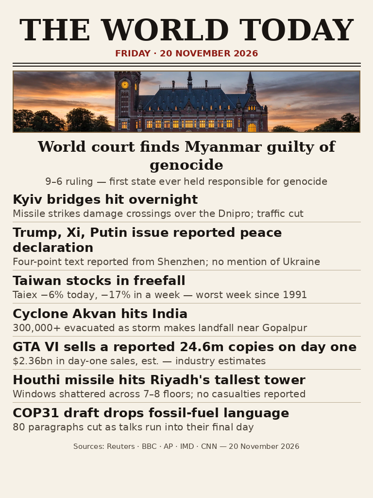

# The World Today — 20 November 2026

[](https://make.fun/c/news-image-20261120)
[](https://make.fun/c/news-image-20261120)
[](https://make.fun/c/news-image-20261120)

Entry for the make.fun competition
[news-image-20261120](https://make.fun/c/news-image-20261120) — sum up
Friday 20 November 2026's world news in one image. Ref:
https://make.fun/r/6wtj6288

`main.py` draws a one-page newspaper front page (768×1024): masthead,
a dusk photo of the Peace Palace in The Hague — home of the International
Court of Justice, whose Myanmar ruling leads the page — and eight stories
from the day: the ICJ genocide ruling, the overnight strikes on Kyiv's
bridges, the reported Trump–Xi–Putin peace declaration from Shenzhen,
Taiwan's stock slide, Cyclone Akvan's landfall in India, GTA VI's
reported day-one sales, the Houthi strike on Riyadh's tallest tower,
and the COP31 draft dropping fossil-fuel language.



## Run it

```sh
mkdir -p out && MAKEFUN_OUTPUT_DIR=out python3 main.py
```

Requires Python 3.13 and Pillow. No network, no timestamps: two runs
write identical bytes. The layout never aborts on overflow — if the
stories run past the vertical budget, the fonts shrink in 2 px steps
and the page is drawn again, down to sane minimum sizes, so a render
always completes. `NEWS_FONT_DIR` may point at a directory of fonts
to render with (DejaVu, then Liberation, then the default font).

## Files

- `main.py` — the program; draws `entry.png` from `scene.png`
- `scene.png` — dusk photo of the Peace Palace, The Hague (1536×512)
- `entry.png` — the rendered front page (768×1024, at most 1 MiB)
- `LICENSE` — MIT

## License

MIT — see [LICENSE](LICENSE).
